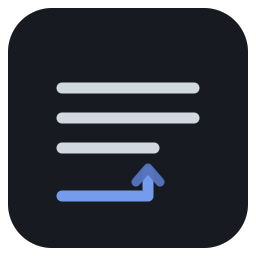
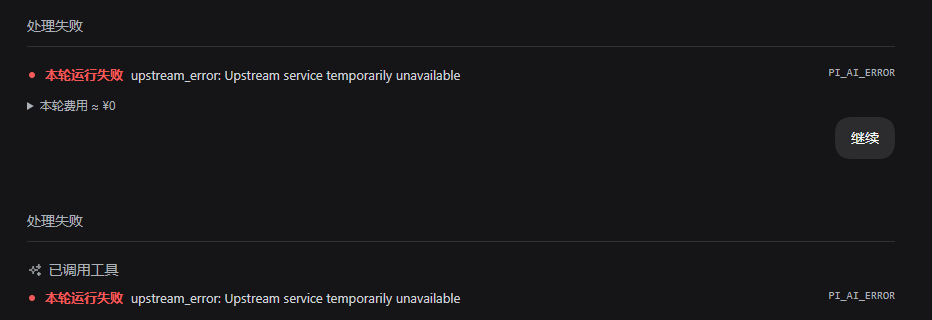
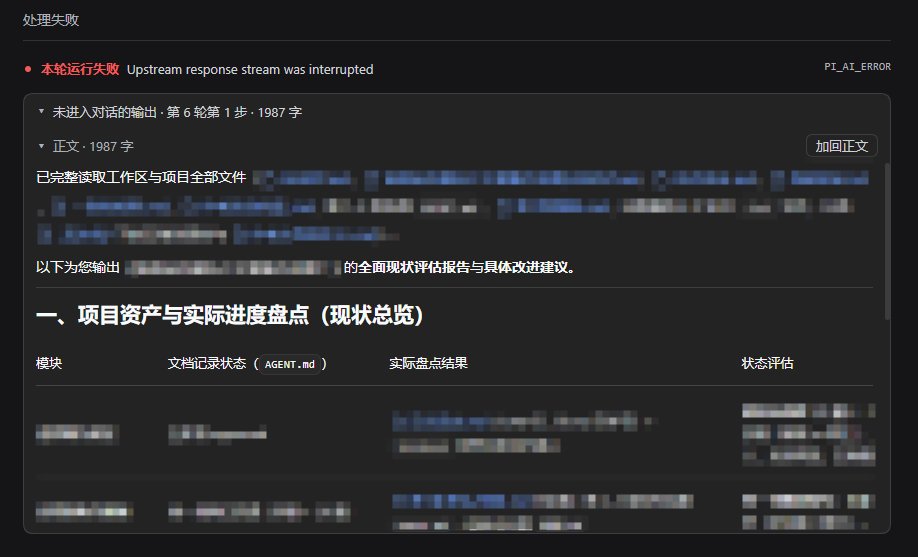
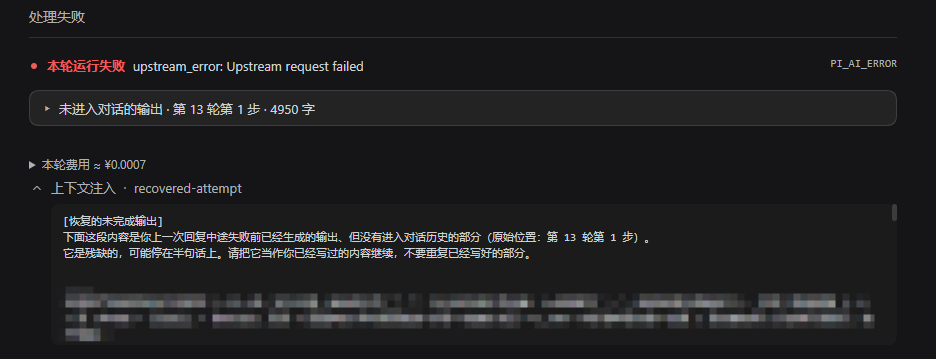

<p align="center">
  
</p>

<h1 align="center">DSH Attempt Recover</h1>

<p align="center">
  <strong>Put the model output that was generated but thrown away back into the conversation</strong><br></p>

<p align="center">
  <a href="https://github.com/UNIEPOpep/dsh-attempt-recover/tags"></a>
  
  <a href="./LICENSE"></a>
  <a href="https://github.com/UNIEPOpep/dsh-attempt-recover/actions/workflows/ci.yml"></a>
  <a href="https://github.com/UNIEPOpep/dsh-attempt-recover"></a>
  
</p>

<p align="center">
  <a href="#quick-start">Quick start</a> ·
  <a href="#the-problem">The problem</a> ·
  <a href="#how-it-works">How it works</a> ·
  <a href="#scope-and-limits">Scope and limits</a> ·
  <a href="./docs/architecture.md">Architecture</a> ·
  <a href="./docs/troubleshooting.md">Troubleshooting</a> ·
  <a href="#contributing">Contributing</a>
</p>

<p align="center"><a href="./README.md">简体中文</a> · <b>English</b></p>

---

> **In one line**: when a model request fails, DeepSeek Harness keeps the generated text in the session log but never renders it. This plugin renders it, then asks whether you want it back in context.

## The problem

When a model request fails — upstream 5xx, dropped connection, `PI_AI_ERROR` — or when you interrupt it halfway, Harness does not discard the text it already generated. It writes the whole thing into the session log as an `assistant/attempt` event (the error branch in `dsh-agent-loop`). That event:

- **has no surface projection** → the model cannot see it on the next turn
- **is read by no chat node** → not a single character reaches the screen

So what you experience is "it had rendered 90%, then one error wiped everything". The text was on your disk the whole time. Nothing was ever willing to draw it.



This plugin does one thing: **draw it, then let you decide**.

## What it looks like

A collapsible block appears at the end of that turn — outside the "process" group, so folding the process away does not hide it:

```
▸ Output that never entered the conversation · turn 3 step 1 · 1247 chars
```

Expanded, it splits into two sections, each with its own button:

```
▾ Output that never entered the conversation · turn 3 step 1 · 1247 chars

  Reasoning · 412 chars                        [ Restore reasoning ]
  ┌──────────────────────────────────────────────┐
  │ Check the … first, then decide… │
  └──────────────────────────────────────────────┘

  Text · 835 chars                             [ Restore text ]
  ┌──────────────────────────────────────────────┐
  │ ## …                                        │
  │                                              │
  │ …                                            │
  │ …                                            │
  └──────────────────────────────────────────────┘
```



Content is rendered as **real Markdown** — headings, lists, tables, fenced code blocks with shiki syntax highlighting, math — exactly like a normal reply.

**If you press nothing, nothing enters context.** The plugin displays; it does not decide for you.

## Quick start

### From npm

```bash
dsh plugin --profile desktop add @uniepopep/dsh-attempt-recover
```

Or with pnpm directly (the profile-side package name is the npm name):

```bash
pnpm add @uniepopep/dsh-attempt-recover --dir ~/.dsh/profiles/desktop
```

### From a local directory

```bash
dsh plugin --profile desktop add /path/to/dsh-attempt-recover
```

You can also paste the absolute path into the "local plugin directory" field of the plugin manager UI.

### After installing

Restart the host (or toggle the plugin off and on), then refresh the page. From then on, every failed request leaves a collapsible block at the end of its turn.

Sanity check:

```bash
curl -i -X POST http://127.0.0.1:YOUR_DSH_PORT/api/attempt-recover
```

`401` is the correct answer — the route is registered and Harness's browser auth is blocking it. `405` means it never got mounted.

## How it works

Three steps:

1. **Observe.** The client subscribes to `ctx.uiConversation.events` and registers a chat node for every `assistant/attempt`.
2. **Rebuild.** The event's `data.stream` is a compact stream; split it by record type:
   - `reasoning-chunks` / `reasoning-delta` → **reasoning**
   - `text-chunks` / `text-delta` → **text**
   - tool-call fragments belong to neither and are neither shown nor restored
3. **Restore.** A button press → `POST /api/attempt-recover { sessionId, seq, section }` → the host verifies this is a real `assistant/attempt` in this session → appends a `user/message` with `surfaceOp: "append"`.

Why step 3 can only write `user/message`: the failed turn is already closed by `turn/end`, and `assistant/message` carries a `requireOpenStep` invariant that rejects it outright. `user/message` has no such constraint.

The restored text then looks like this (the framing has to be written into `content` by hand, because the surface projection of `user/message` is a pass-through):

```
[Recovered partial output]
The block below is content you had already generated before your previous reply failed midway; it never entered the conversation history (originally turn 3, step 1).
It is incomplete and may stop mid-sentence. Treat it as something you have already written and continue from there; do not repeat what is already written.

-----
<original text>
-----
```

Without that framing the model would assume the user pasted someone else's content.



More detail in [docs/architecture.md](./docs/architecture.md).

## Why it sits outside the "process" group

Failed turns fold a lot of activity into a single "process" group. A regular chat node would be folded into it too — exactly when hiding it is the worst thing to do.

So the node is declared `visibility: "hidden"` and rendered through the `conversation.chat.turnTail` slot instead. `turn-tail` is a member of `TURN_PROCESS_INDEPENDENT_KINDS`, so it never participates in process folding. Fold the whole turn's process away and this block still sits at the end of the turn.

## Scope and limits

**No configuration.** Install it and it works. Nothing is persisted.

Deliberately out of scope:

- **Only `assistant/attempt`.** Successful replies already render; they do not need this.
- **Attempts where both sections are empty are not rendered.** A failure that produced no characters should not create noise.
- **No auto-retry, no auto-restore.** Whether to restore is your call; the plugin does not guess.
- **No auth bypass.** Restoring goes through `/api/attempt-recover`, guarded by Harness's browser auth.
- **No patching Harness.** Only public plugin extension points are used.

Known limitations:

- Historical `assistant/attempt` events are rescanned after a **host restart**; a page refresh is enough to re-match events that already exist.
- If one turn has several failed attempts (repeated retries all failing), they stack at the end of the turn in seq order, each with independent expanded state.
- Requires DSH 0.2.2-rc.2 or newer. Earlier versions may have no `assistant/attempt` event, so the plugin would have nothing to show.

## Compatibility

| Item | Requirement |
| --- | --- |
| DeepSeek Harness | ≥ 0.2.2-rc.2 |
| Platform | Web / desktop (author runs desktop; web untested) |
| Node | ≥ 22 |
| Host dependencies | `node:crypto` only; zero third-party runtime dependencies |

The host half imports **only** `node:` built-ins. That is not fastidiousness, it is a requirement: the plugin is installed into the profile through a symlink, the real path has no `node_modules`, and any bare `@deepseek-ai/*` specifier fails to resolve at runtime. The handler then throws, `bridge` writes no response body, and the browser reports `Unexpected end of JSON input`. `e2e.mjs` guards this by running in the no-`node_modules` shape.

## Project layout

```
.
├── index.js              # host half: /api/attempt-recover route and append logic
├── client.js             # browser half: turnTail block, Markdown rendering, restore buttons
├── cordis.patch.yml      # inserts the plugin into the profile's plugin tree
├── package.json          # dsh.bundle.patch + dsh.client declarations
├── selfcheck.mjs         # 47 contract assertions
├── e2e.mjs               # 20 end-to-end assertions
├── LICENSE               # AGPL-3.0 with the UNIEPOpep attribution block
├── README.md / README.en.md
├── CHANGELOG.md / CONTRIBUTING.md / SECURITY.md
├── assets/               # screenshots used by the README
├── .github/              # CI matrix and issue / PR templates
├── scripts/make-icon.mjs # icon generator (maintainer-facing, zero-dependency PNG writer)
└── docs/
    ├── architecture.md   # event flow, extension-point choices, rationale
    ├── troubleshooting.md
    ├── releasing.md      # maintainer release checklist
    └── assets/icon.png   # plugin icon
```

## Development

```bash
git clone https://github.com/UNIEPOpep/dsh-attempt-recover.git
cd dsh-attempt-recover

npm test          # 47 + 20 assertions
npm run pack:dry  # preview what would be published
```

The two suites split the work: `selfcheck.mjs` checks contract shape (exports, routes, node construction, rendered copy, Markdown props), while `e2e.mjs` exercises the append path in the real no-`node_modules` shape.

Install your working copy:

```bash
dsh plugin --profile desktop add "$(pwd)"
```

Debugging hint: if `apply` never runs on the host, add a temporary `appendFileSync` probe in the plugin directory. If the route never mounted, `POST` returns `405` — not `404`. More in [docs/troubleshooting.md](./docs/troubleshooting.md).

## Contributing

Issues and PRs are welcome. Before submitting:

1. `npm test` is green
2. New behavior comes with matching assertions
3. No runtime dependencies (see Compatibility above — `e2e.mjs` enforces this directly)

For anything substantial, open an issue first so we can agree on the shape.

## License

Copyright (C) 2026 UNIEPOpep &lt;https://github.com/UNIEPOpep&gt;

Released under the **GNU Affero General Public License v3.0**. The full text is in [LICENSE](./LICENSE).

You may use, modify, and redistribute this software, including commercially, provided you keep the author's signature, copyright and license notices. If you offer it to others as a network service, you must also publish your modified source under AGPL-3.0. The LICENSE file is authoritative.

## Acknowledgements

- [DeepSeek Harness](https://github.com/deepseek-ai) — for extension points clean enough that this plugin does not touch a single line of its source.
- Everyone this has happened to.
