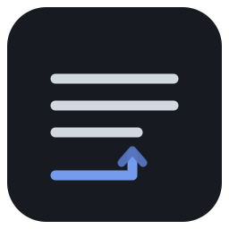
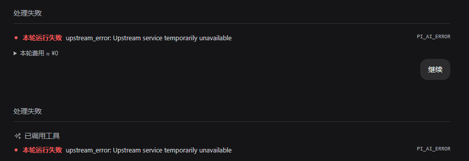
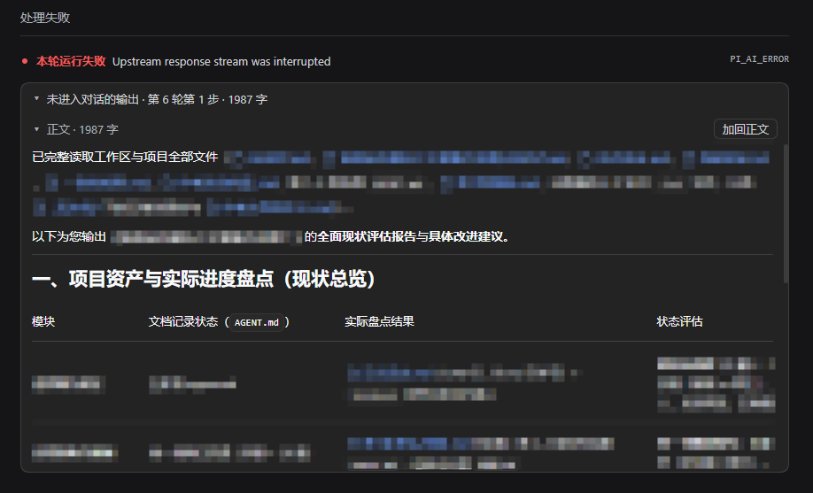
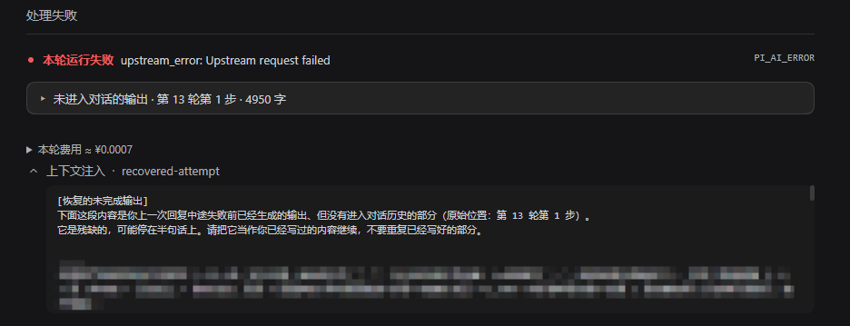

<p align="center">
  
</p>

<h1 align="center">DSH Attempt Recover</h1>

<p align="center">
  <strong>把「已经写出来、却被丢掉」的模型输出，重新还给对话</strong><br></p>

<p align="center">
  <a href="https://github.com/UNIEPOpep/dsh-attempt-recover/tags"></a>
  
  <a href="./LICENSE"></a>
  <a href="https://github.com/UNIEPOpep/dsh-attempt-recover/actions/workflows/ci.yml"></a>
  <a href="https://github.com/UNIEPOpep/dsh-attempt-recover"></a>
  
</p>

<p align="center">
  <a href="#快速开始">快速开始</a> ·
  <a href="#它解决什么问题">它解决什么</a> ·
  <a href="#它怎么工作">工作原理</a> ·
  <a href="#配置与边界">配置与边界</a> ·
  <a href="./docs/architecture.md">架构</a> ·
  <a href="./docs/troubleshooting.md">排错</a> ·
  <a href="#参与贡献">参与贡献</a>
</p>

<p align="center"><b>简体中文</b> · <a href="./README.en.md">English</a></p>

---

> **一句话**：DeepSeek Harness 在模型请求失败时，会把已经生成的内容写进会话日志却不在界面上显示。这个插件把它画出来，问你一句「要不要加回去」。

## 它解决什么问题

一次模型请求失败（上游 5xx、连接中断、`PI_AI_ERROR`……）或被你中途打断时，Harness 不会丢掉已经生成的文本 —— 它把整段内容写进会话日志的 `assistant/attempt` 事件（`dsh-agent-loop` 的错误分支）。但这个事件：

- **没有 surface 投影** → 模型下一轮看不见它
- **没有任何 Chat 节点读取它** → 界面上一个字都不显示

于是你看到的现象是「明明已经输出了 90%，一个报错全没了」。文本一直在你的磁盘上，只是没有组件愿意把它画出来。



这个插件只做一件事：**把它画出来，然后让你决定**。

## 效果

在该轮末尾出现一个折叠块（它不在「过程」分组里，折起过程也照样显示）：

```
▸ 未进入对话的输出 · 第 3 轮第 1 步 · 1247 字
```

展开后分两节，各带一个按钮：

```
▾ 未进入对话的输出 · 第 3 轮第 1 步 · 1247 字

  思考 · 412 字                             [ 加回思考 ]
  ┌──────────────────────────────────────────────┐
  │ 先确认……，再决定这一章要不要……        │
  └──────────────────────────────────────────────┘

  正文 · 835 字                             [ 加回正文 ]
  ┌──────────────────────────────────────────────┐
  │ ## ……                            │
  │                                              │
  │ ……                       │
  │ ……                                           │
  └──────────────────────────────────────────────┘
```



展开内容按 **Markdown 正常渲染** —— 标题、列表、表格、围栏代码块（带 shiki 语法高亮）、公式，与真实回复一致。

**不点按钮，什么都不会进上下文。** 插件只负责显示，不替你做决定。

## 快速开始

### 从 npm 安装

```bash
dsh plugin --profile desktop add @uniepopep/dsh-attempt-recover
```

用 pnpm 直接装也一样（profile 里的包名就是 npm 包名）：

```bash
pnpm add @uniepopep/dsh-attempt-recover --dir ~/.dsh/profiles/desktop
```

### 从本地目录安装

```bash
dsh plugin --profile desktop add /path/to/dsh-attempt-recover
```

也可以直接在这个应用的插件管理界面里填「本地插件目录」的绝对路径。

### 装完要做什么

重启 DSH（正常应该不用重启，刷新即可），刷新页面。之后每一次失败的请求，都会在那一轮末尾多出一个折叠块。

装好之后可以这样自检：

```bash
curl -i -X POST http://127.0.0.1:YOUR_DSH_PORT/api/attempt-recover
```

返回 `401` 是对的 —— 说明路由已注册、被 Harness 的浏览器鉴权挡住。返回 `405` 才说明没挂上。

## 它怎么工作

三个步骤：

1. **监听**。客户端订阅 `ctx.uiConversation.events`，对每一个 `assistant/attempt` 注册一个 Chat 节点。
2. **还原**。事件里的 `data.stream` 是紧凑流，按记录类型拆成两段：
   - `reasoning-chunks` / `reasoning-delta` → **思考**
   - `text-chunks` / `text-delta` → **正文**
   - tool-call 片段不属于任何一段，不显示也不加回
3. **加回**。点按钮 → `POST /api/attempt-recover { sessionId, seq, section }` → 宿主校验这是本会话里真实存在的 `assistant/attempt` → 追加一条 `user/message`，带 `surfaceOp: "append"`。

第 3 步为什么只能写 `user/message`：失败轮次的 turn 已经被 `turn/end` 闭合，`assistant/message` 的 invariant 是 `requireOpenStep`，会被直接拒绝；而 `user/message` 没有这个约束。

于是加回去的文本长这样（框架文字必须自己写进 content —— `user/message` 的 surface 投影是原样透传）：

```
[恢复的未完成输出]
下面这段内容是你上一次回复中途失败前已经生成的输出、但没有进入对话历史的部分（原始位置：第 3 轮第 1 步）。
它是残缺的，可能停在半句话上。请把它当作你已经写过的内容继续，不要重复已经写好的部分。

-----
<原文>
-----
```

少了这段说明，模型会以为这是用户贴进来的别人的内容。



细节见 [docs/architecture.md](./docs/architecture.md)。

## 为什么它在「过程」分组之外

失败的轮次会把大量活动折叠进一个「过程」分组。如果插件节点是普通 Chat 节点，它会跟着被折进去 —— 那正好是最不该藏起来的时候。

所以节点声明为 `visibility: "hidden"`，改由 `conversation.chat.turnTail` 槽渲染。`turn-tail` 在 `TURN_PROCESS_INDEPENDENT_KINDS` 集合里，不参与过程折叠。你手动折起那一整轮的过程，这块仍然固定显示在轮的末尾。

## 配置与边界

**没有配置项。** 装上就生效，不做任何持久化设置。

明确不做的事：

- **只处理 `assistant/attempt`。** 正常完成的回复本来就会显示，不需要它。
- **两段都为空的 attempt 不渲染。** 一个字都没产出的失败不该制造噪音。
- **不自动重试、不自动加回。** 加不加回是你的判断，插件不猜。
- **不绕过鉴权。** 加回走 `/api/attempt-recover`，受 Harness 的浏览器鉴权保护。
- **不改 Harness 源码。** 只用公开的插件扩展点。

已知限制：

- 历史 `assistant/attempt` 事件在**重启 DSH** 后才会重新扫描；页面刷新足以让已有事件重新匹配。
- 同一轮里若有多条失败的 attempt（重试多次都失败），它们按 seq 顺序堆在轮末尾，各自的展开状态独立。
- 需要 DSH 0.2.2-rc.2 及以上。更早的版本 可能 没有 `assistant/attempt` 事件，插件装了也不会有东西可显示。

## 兼容性

| 项目             | 要求                                                  |
| ---------------- | ----------------------------------------------------- |
| DeepSeek Harness | ≥ 0.2.2-rc.2（插件作者的版本；更早的版本不保证可用） |
| 平台             | Web / 桌面端（作者为桌面端，web端未测试）             |
| Node             | ≥ 22                                                 |
| 宿主依赖         | 仅 `node:crypto`，不引入任何第三方运行时依赖          |

宿主侧**只** import `node:` 内建模块：插件通过符号链接装进 profile，真实路径下没有 `node_modules`，任何裸 `@deepseek-ai/*` 说明符都会在运行时解析失败 —— 那样 handler 会抛异常，`bridge` 不写响应体，浏览器就报 `Unexpected end of JSON input`。`e2e.mjs` 用无 `node_modules` 的运行形态守住这条约束。

## 项目结构

```
.
├── index.js              # 宿主侧：/api/attempt-recover 路由与追加逻辑
├── client.js             # 浏览器侧：turnTail 折叠块、Markdown 渲染、加回按钮
├── cordis.patch.yml      # 把插件插进 profile 的插件树
├── package.json          # dsh.bundle.patch + dsh.client 声明
├── selfcheck.mjs         # 47 条契约断言
├── e2e.mjs               # 20 条端到端断言
├── LICENSE               # AGPL-3.0（含 UNIEPOpep 署名块）
├── README.md / README.en.md
├── CHANGELOG.md / CONTRIBUTING.md / SECURITY.md
├── assets/               # README 配图（三张截图）
├── .github/              # CI 矩阵与 issue / PR 模板
├── scripts/make-icon.mjs # 生成图标（维护用，零依赖手写 PNG）
└── docs/
    ├── architecture.md   # 事件流、扩展点选择、为什么这么写
    ├── troubleshooting.md
    ├── releasing.md      # 维护者发布清单
    └── assets/icon.png   # 插件图标
```

## 开发

```bash
git clone https://github.com/UNIEPOpep/dsh-attempt-recover.git
cd dsh-attempt-recover

npm test          # 47 + 20 条断言
npm run pack:dry  # 看看会发布哪些文件
```

两个测试套件的分工：`selfcheck.mjs` 校验契约形状（导出、路由、节点构造、渲染文案、Markdown 参数），`e2e.mjs` 在无 `node_modules` 的真实形态下跑一遍追加链路。

改完装到本地试用：

```bash
dsh plugin --profile desktop add "$(pwd)"
```

调试提示：宿主的 `apply` 若没跑，先在插件目录里加一行 `appendFileSync` 探针；路由没挂上时 `POST` 会返回 `405`（不是 `404`）。更多见 [docs/troubleshooting.md](./docs/troubleshooting.md)。

## 参与贡献

欢迎 issue 和 PR。提交前请确保：

1. `npm test` 全绿
2. 新增行为有对应的断言
3. 不引入运行时依赖（见上面的兼容性说明 —— 这条会被 `e2e.mjs` 直接拦下）

有大改动先开个 issue 聊聊，避免白写。

## 许可证

Copyright (C) 2026 UNIEPOpep &lt;https://github.com/UNIEPOpep&gt;

本项目以 **GNU Affero General Public License v3.0** 发布，全文见 [LICENSE](./LICENSE)。

你可以自由使用、修改、分发，包括商用；条件是保留作者署名、版权与许可证声明，并且如果你把它作为网络服务提供给他人使用，必须同样以 AGPL-3.0 公开你修改后的源代码。完整条款以 LICENSE 为准。

## 致谢

- [DeepSeek Harness](https://github.com/deepseek-ai) —— 提供了干净可用的插件扩展点，这个插件没有修改它一行源码。
- 被这个问题折磨过的每一个人。
